# MentDev · Dashboard comercial de cotizaciones 2026 (Excel)


Libro de Excel que modela el seguimiento comercial de **MentDev**: embudo de cotizaciones, conversión, rentabilidad por línea de servicio y cumplimiento de metas mensuales. Todo el análisis se resuelve con tablas, fórmulas, validación de datos, formato condicional y gráficos nativos, construido íntegramente en **Excel para la Web (Microsoft 365)**.

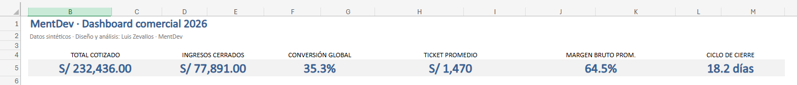

| | |
|---|---|
| 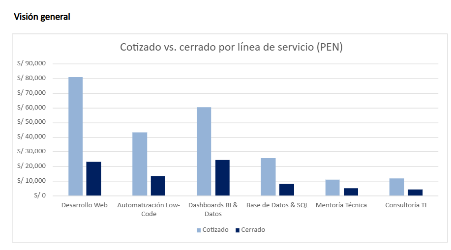 | 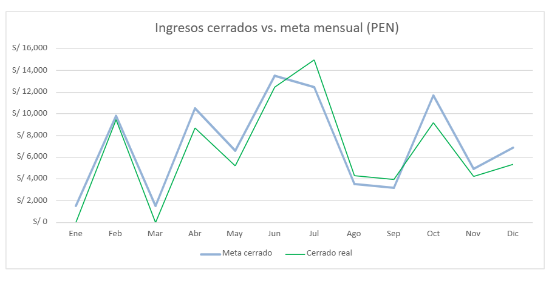 |
| 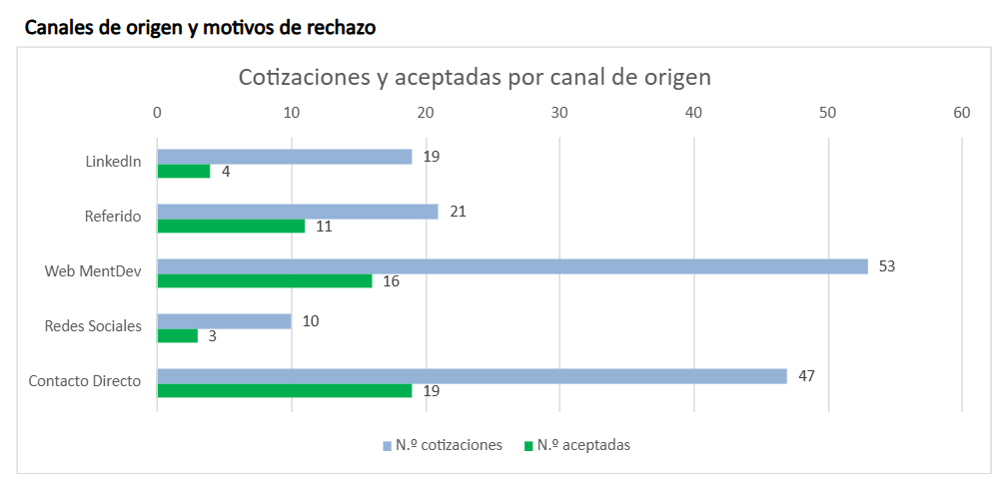 | 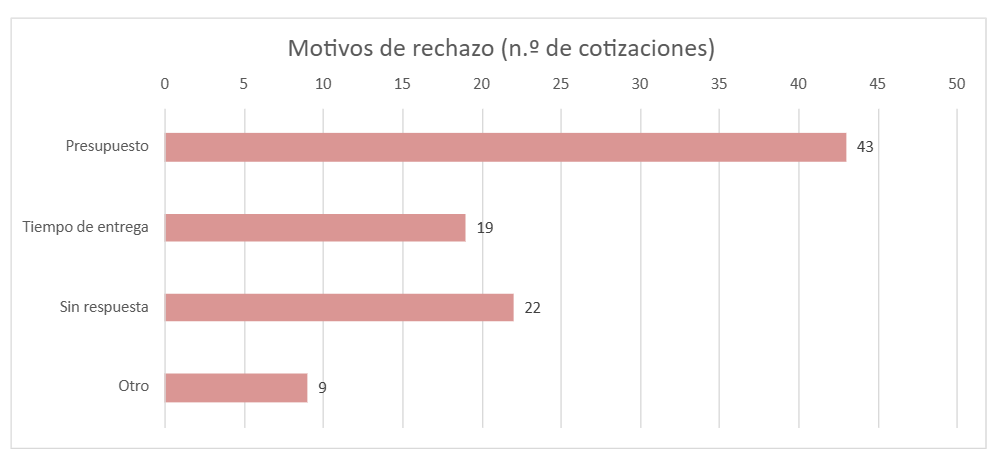 |

## Aviso importante: datos ficticios

**Los valores de este proyecto no son reales.** Las 150 cotizaciones, los clientes (`Cliente_001`…), los montos, los márgenes y las metas mensuales son **datos sintéticos**, generados programáticamente con semilla fija (reproducibles), para proteger la confidencialidad comercial de clientes reales.

Aun así, el dataset se diseñó con supuestos verosímiles del negocio: estacionalidad mensual, tarifas y horas distintas por servicio, probabilidad de cierre según canal, complejidad y descuento, y ciclos de cierre diferenciados. El objetivo es doble:

1. **Mostrar la lógica y el funcionamiento** de cómo MentDev cotiza, cierra y mide su operación comercial.
2. **Demostrar un nivel sólido de Excel** mediante un análisis completo, aunque ficticio.

Los hallazgos de este documento describen **el dataset simulado**, no resultados reales de ningún negocio.

## Qué demuestra este proyecto

- Modelado de datos en tablas: catálogos, tabla transaccional y capa analítica.
- Columnas calculadas con búsquedas cruzadas entre hojas (`INDICE` + `COINCIDIR`).
- KPIs con agregaciones multicriterio y control de errores.
- Seguimiento de metas con formato condicional (semáforo).
- Visualización con gráficos nativos y diseño pensado para lectura ejecutiva.
- Documentación del propio libro (diccionario de variables y reglas de negocio).

## Arquitectura del libro (`MentDev_Cotizaciones_Comercial.xlsx`)

| Hoja | Rol | Contenido |
|---|---|---|
| `Catalogo_Parametros` | Dimensiones y parámetros | `Tbl_Servicios`, `Tbl_Metas_Mensuales`, `Tbl_Complejidad`, costo por hora, fecha de corte, año y listas de validación |
| `Base_Cotizaciones` | Tabla transaccional | `Tbl_Cotizaciones`: 150 filas; columnas A–K de entrada y L–R calculadas |
| `Dashboard_KPIs` | Capa analítica | 6 KPIs, 4 gráficos, cumplimiento mensual con semáforo y tablas por línea, canal y motivo de rechazo |
| `Diccionario_y_Guia` | Documentación | Propósito, diccionario de variables, reglas de negocio y notas técnicas |

`Catalogo_Parametros` alimenta a `Base_Cotizaciones` (listas desplegables y búsquedas) y ambas alimentan a `Dashboard_KPIs`.

### 1. Catálogo y parámetros

Tablas maestras con tarifas, horas y margen objetivo por servicio, metas mensuales ficticias, factores de complejidad y listas para la validación de datos.

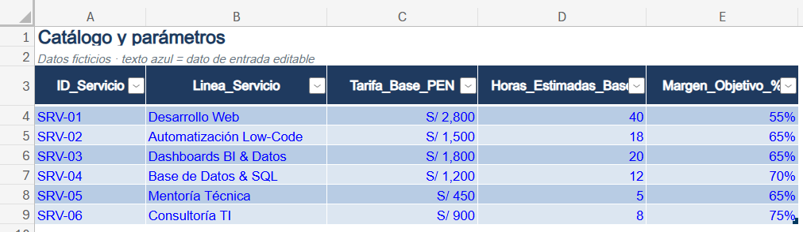
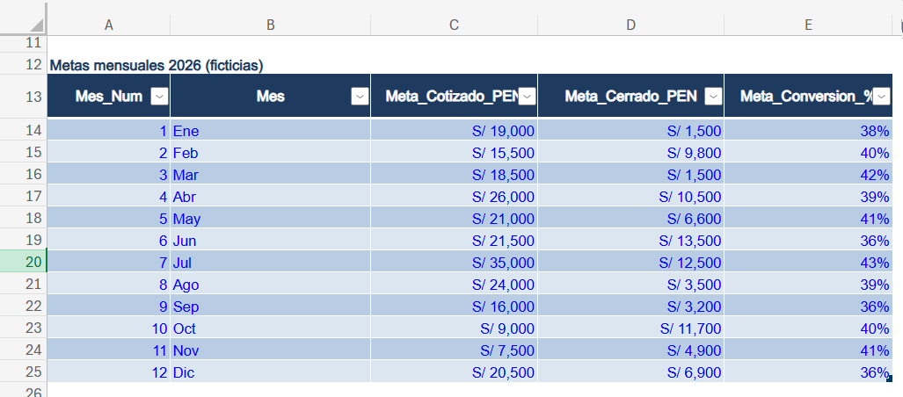
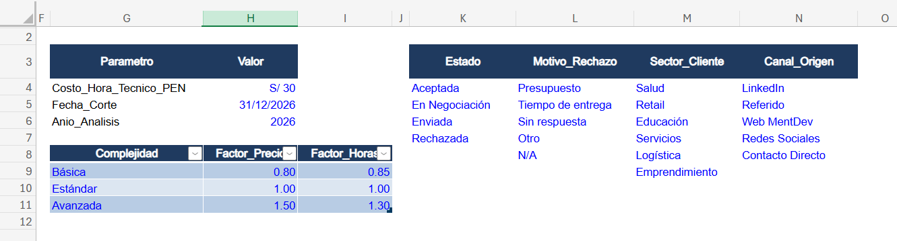

### 2. Base de cotizaciones

Tabla transaccional con 150 cotizaciones. Las columnas de entrada (A–K) usan listas desplegables; las columnas L–R son fórmulas:

- `Monto_Cotizado_PEN` = tarifa base × factor de precio (complejidad) × (1 − descuento).
- `Costo_Operativo_PEN` = horas base × factor de horas × costo por hora técnico.
- `Margen_Bruto_PEN` = monto − costo; `Margen_%` = margen / monto.
- `Dias_Ciclo` = fecha de cierre − fecha de emisión (si sigue abierta, usa la fecha de corte).

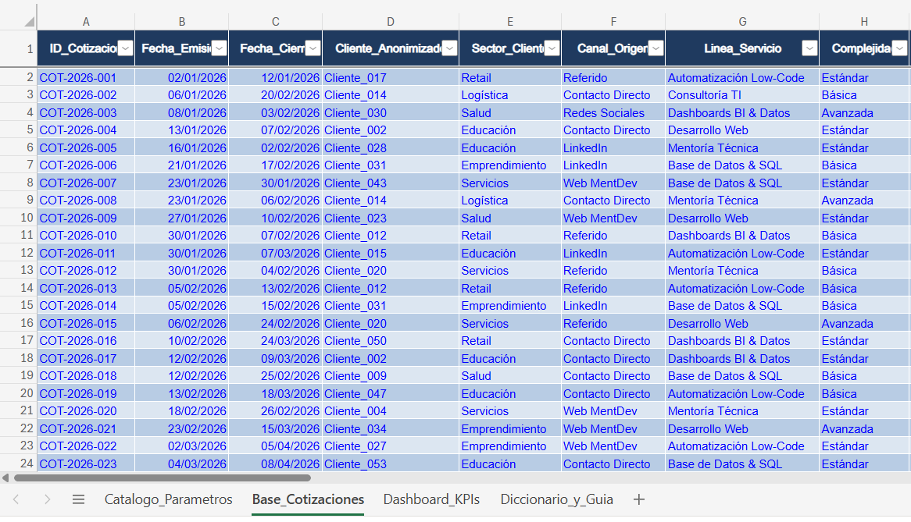
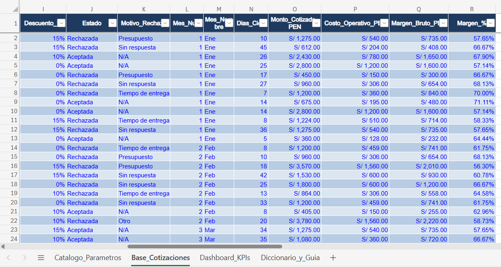

### 3. Dashboard de KPIs

Seis indicadores superiores, cuatro gráficos y tres tablas de soporte. El cumplimiento mensual usa un semáforo (verde ≥ 100 %, ámbar 80–99 %, rojo < 80 %).

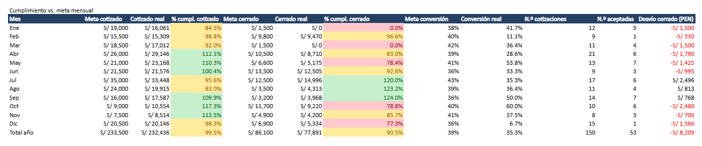
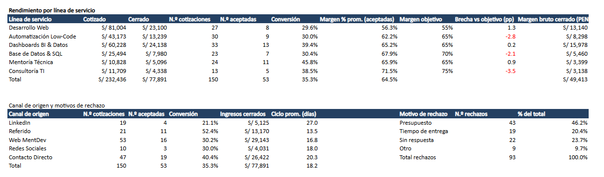

### 4. Diccionario y guía

Documentación dentro del propio libro: propósito, aviso de datos sintéticos, diccionario de variables, reglas de negocio y notas técnicas.

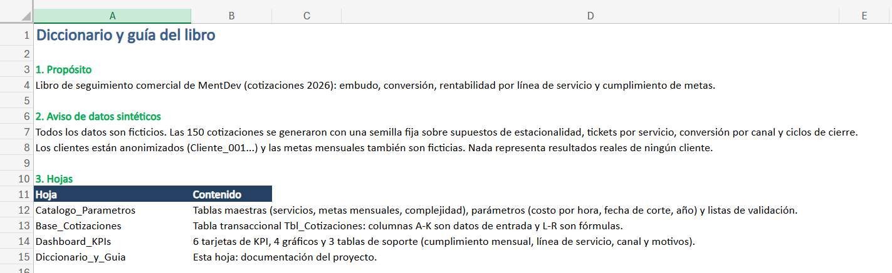
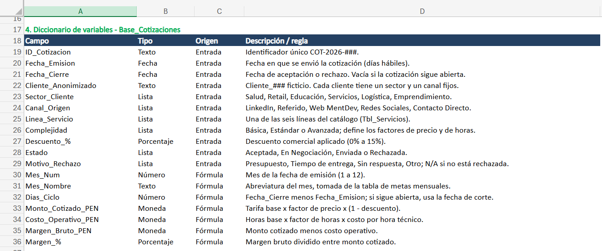
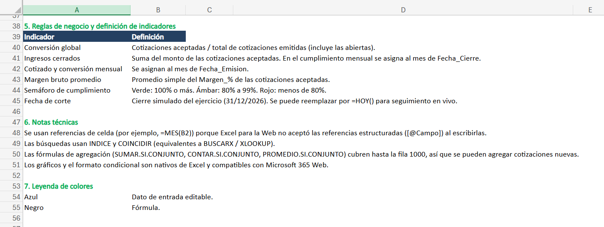

## Técnicas de Excel utilizadas

- **Tablas** de Excel para organizar catálogos y registros, con filtros y base para tablas dinámicas.
- **Validación de datos** con listas desplegables vinculadas al catálogo.
- **Búsquedas** con `INDICE` / `COINCIDIR` (equivalente a `BUSCARX`).
- **Agregaciones multicriterio:** `SUMAR.SI.CONJUNTO`, `CONTAR.SI.CONJUNTO`, `PROMEDIO.SI.CONJUNTO`.
- **Control de errores y lógica condicional:** `SI.ERROR`, `SI`.
- **Fechas:** `FECHA`, `MES` para asignar los ingresos al mes de cierre.
- **Formato condicional** tipo semáforo para el cumplimiento de metas.
- **Gráficos nativos:** columnas agrupadas, líneas y barras horizontales.

## Hallazgos del dataset simulado

> Con 150 cotizaciones, algunas categorías tienen muestras pequeñas: son señales ilustrativas, no conclusiones estadísticas.

- **KPIs globales:** S/ 232,436 cotizados, S/ 77,891 cerrados, conversión de 35.3 %, ticket promedio de S/ 1,470, margen bruto promedio de 64.5 % y ciclo de cierre de 18.2 días.
- **Cumplimiento de metas:** el cotizado alcanza el 99.5 % de la meta anual y lo cerrado, el 90.5 %. Julio, agosto y septiembre superan la meta de cierre; enero y marzo no registran ingresos cerrados.
- **Volumen vs. rentabilidad:** Desarrollo Web concentra el mayor monto cotizado (S/ 81,004), pero convierte solo 29.6 % y su margen (56.3 %) queda apenas sobre el objetivo. Dashboards BI & Datos genera el mayor ingreso cerrado (S/ 24,138), con 39.4 % de conversión y 65.2 % de margen.
- **Canales:** *Referido* convierte 52.4 % y cierra en 13.5 días en promedio, frente a 30.2 % de *Web MentDev*, el canal de mayor volumen (53 cotizaciones). *LinkedIn* tiene el ciclo más largo (27 días).
- **Margen vs. objetivo:** Base de Datos & SQL, Automatización Low-Code y Consultoría TI quedan entre 2 y 3.5 puntos porcentuales por debajo de su margen objetivo.
- **Rechazos:** *Presupuesto* explica el 46.2 % de las cotizaciones rechazadas y *Sin respuesta*, el 23.7 %.

## Decisiones técnicas y limitaciones

- **Referencias de celda en lugar de referencias estructuradas.** En Excel para la Web, las fórmulas con `[@Campo]` no se aceptaron al escribirlas, así que las columnas calculadas usan referencias normales (por ejemplo, `=MES(B2)`). El resultado es el mismo, y las tablas siguen aportando filtros y soporte para tablas dinámicas.
- **`INDICE` / `COINCIDIR` en vez de `BUSCARX`.** Máxima compatibilidad entre versiones de Excel.
- **Fecha de corte fija (31/12/2026).** Mantiene estables los resultados; puede reemplazarse por `=HOY()` para seguimiento en vivo.
- **Rangos hasta la fila 1000.** Permiten agregar cotizaciones nuevas sin modificar las fórmulas del dashboard.
- **Ingresos por mes de cierre.** El cumplimiento de la meta de cierre se asigna al mes de `Fecha_Cierre`; el cotizado y la conversión, al mes de `Fecha_Emision`.

## Cómo usarlo

1. Descarga `MentDev_Cotizaciones_Comercial.xlsx` y ábrelo en Excel (escritorio o Web).
2. Edita tarifas, factores y metas en `Catalogo_Parametros` (texto azul = dato de entrada).
3. Agrega cotizaciones al final de `Tbl_Cotizaciones`; el dashboard se actualiza solo.
4. Consulta `Diccionario_y_Guia` para el detalle de cada campo y de cada indicador.

## Estructura del repositorio

```
mentdev-comercial-excel/
├── MentDev_Cotizaciones_Comercial.xlsx
├── README.md
└── img/
    ├── hoja-catalogo-A.png … C.png
    ├── hoja-cotizaciones-A.png … B.png
    ├── hoja-dashboard-A.png … G.png
    └── hoja-diccionario-guia-A.png … C.png
```

---
*Diseño y análisis: Luis Zevallos · MentDev*
